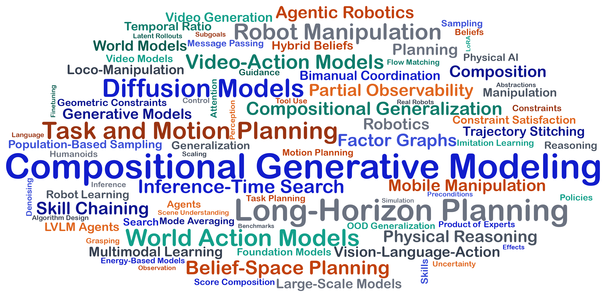

<!--  -->

  

   

   

  

  

   

- :sparkles: I'm developing compositional generative models for long-horizon robot planning and physical reasoning.
- :mortar_board: You can find my current research interests [here](https://umishra.me/)
- :trollface: Ping me up if you want to talk about robots, life, music, movies and memes

   

 

## Research

Below is a cloud of keywords you will find quite frequently in my publications!

